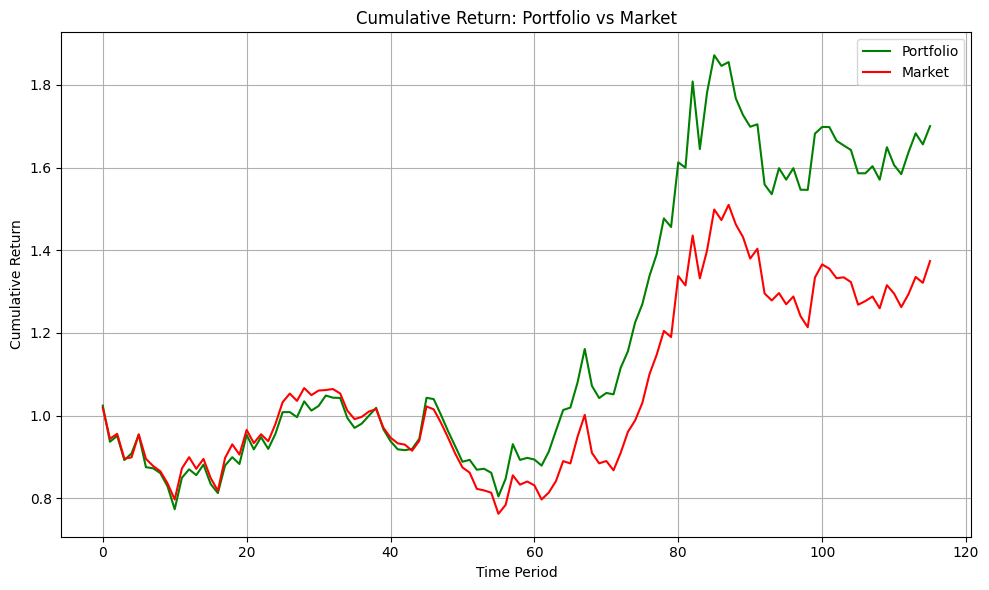
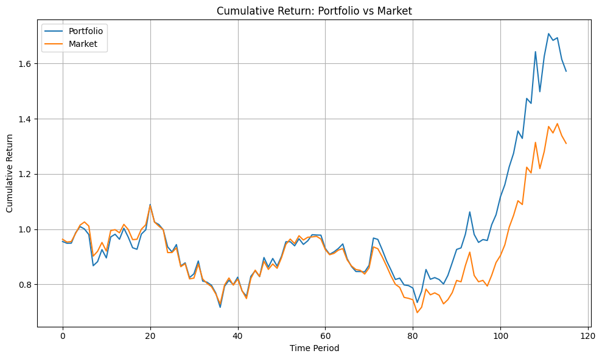
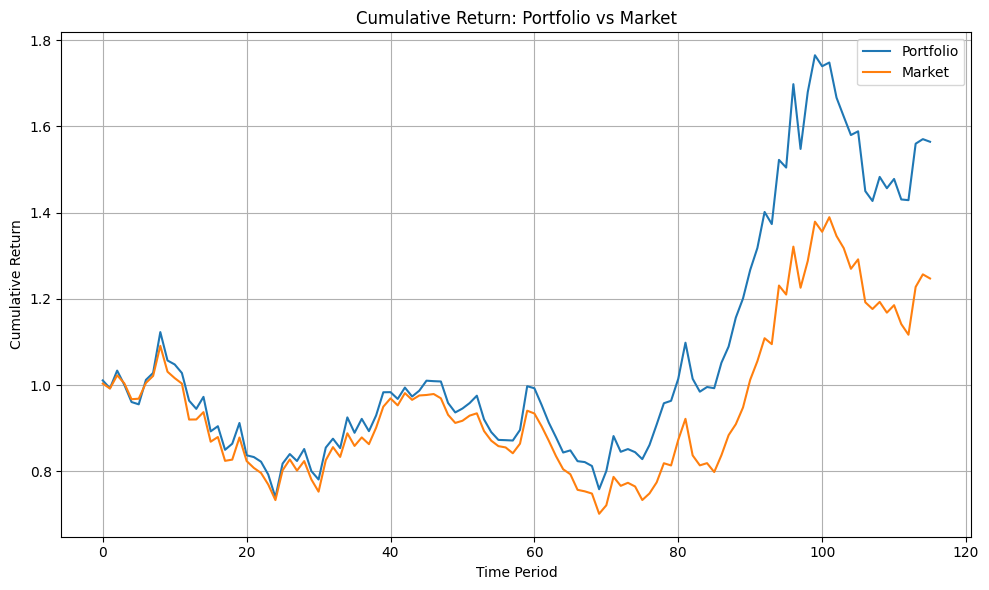
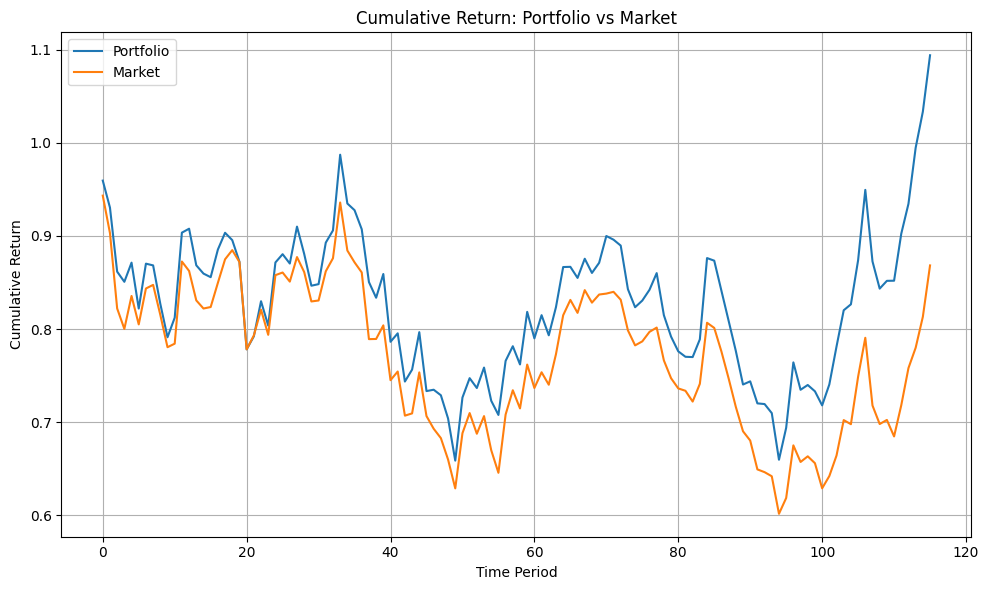

# Iranian Stock Market Portfolio Optimization

### Benchmark-relative asset allocation with reproducible linear programming

[](https://www.python.org/) [](https://www.pyomo.org/) [](#quality-checks)

A **long-only stock portfolio allocation** workflow applied to four Iranian equity datasets. The allocation problem is formulated as a **benchmark-relative linear program**, solved with Pyomo and GLPK, and evaluated both on the full history and with a **chronological holdout** to separate historical fit from out-of-sample performance.

---

## At a glance

| Component | Design |
| --- | --- |
| **Domain** | Iranian equity price data with a market benchmark |
| **Method** | Linear programming (LP), solved with **Pyomo + GLPK** |
| **Portfolio** | Fully invested, long only: $w_i \ge 0$, $\sum_i w_i = 1$ |
| **Risk constraint** | In every training period, portfolio return stays within $k$ of the benchmark |
| **Experiments** | Four historical datasets (`Dataset1.xlsx`–`Dataset4.xlsx`) |
| **Evaluation** | Full-sample fit and chronological train/test split |
| **Outputs** | Portfolio weights, return series, wealth curves, summary tables |

## Motivation

Instead of picking stocks heuristically, this project turns the allocation decision into an **explicit optimization problem** with a clear objective and constraints. The evaluation protocol separates **in-sample fit** from **out-of-sample performance**, which is essential for assessing any quantitative strategy.

## Optimization model

For $n$ assets over $T$ training periods, let $r_{i,t}$ be the return of asset $i$, $b_t$ the benchmark return, $w_i$ the portfolio weight, and $k$ the allowed underperformance per period.

$$
\begin{aligned}
\max_{w}\quad & \frac{1}{T}\sum_{t=1}^{T}\left(\sum_{i=1}^{n}w_i r_{i,t}-b_t\right) \\
\text{subject to}\quad & \sum_{i=1}^{n} w_i = 1, \quad w_i \ge 0, \\
& \sum_{i=1}^{n}w_i r_{i,t}\ge b_t-k, \qquad \forall t\in\mathcal{T}_\mathrm{fit}.
\end{aligned}
$$

The model maximizes the average **active return** (portfolio return minus benchmark return) while ensuring the portfolio never falls more than $k$ below the benchmark in any training period. The experiments use **$k = 0.02$**, i.e. a maximum shortfall of two percentage points per period.

## Repository layout

```text
Iranian-Stock-Market-Portfolio-Optimization/
├── README.md
├── notebooks/
│   └── Iranian_Stock_Market_Portfolio_Optimization.ipynb
├── src/
│   └── portfolio_optimizer.py        # data loading, Pyomo LP model, evaluation metrics
├── scripts/
│   ├── run_portfolio.py              # command-line interface for all datasets
│   ├── generate_synthetic_example.py
│   └── pre_publish_check.py
├── tests/
│   └── test_portfolio_optimizer.py
├── data/
│   ├── example/synthetic_price_matrix.csv   # synthetic demo data
│   └── raw/README.md                        # place your Excel files here
├── docs/
│   ├── HISTORICAL_RESULTS.md
│   ├── historical_outputs.json
│   └── figures/
├── requirements.txt
└── .github/workflows/ci.yml
```

## Installation

Requirements: **Python 3.10+**, the GLPK solver (`glpsol`), and the packages in `requirements.txt`.

**macOS (Homebrew)**

```bash
brew install glpk
python3 -m venv .venv
source .venv/bin/activate
python -m pip install -r requirements.txt
```

**Ubuntu/Debian:** `sudo apt-get install -y glpk-utils` · **Conda:** `conda install -c conda-forge glpk`

## Quick start

Run the optimizer on the included synthetic example:

```bash
python scripts/run_portfolio.py --files data/example/synthetic_price_matrix.csv --k 0.02
```

This writes portfolio weights, summary metrics, and wealth charts to `results/`.

You can also open [`notebooks/Iranian_Stock_Market_Portfolio_Optimization.ipynb`](notebooks/Iranian_Stock_Market_Portfolio_Optimization.ipynb) in Jupyter or VS Code and run the cells in order.

## Running on your own data

Place the Excel files in `data/raw/`:

```text
data/raw/Dataset1.xlsx
data/raw/Dataset2.xlsx
data/raw/Dataset3.xlsx
data/raw/Dataset4.xlsx
```

Then run:

```bash
python scripts/run_portfolio.py --files data/raw/Dataset1.xlsx data/raw/Dataset2.xlsx data/raw/Dataset3.xlsx data/raw/Dataset4.xlsx --k 0.02 --train-fraction 0.7
```

### Input format

- **Rows:** one asset per row; the **last row is the benchmark**.
- **Columns:** consecutive time periods, ordered from oldest to newest.
- **Cells:** positive prices with no missing values.
- **Names (optional):** a first text column with asset tickers. Without it, assets are labeled `Asset_01`, `Asset_02`, and so on.
- **Sheet:** the first sheet is used by default; use `--sheet` to choose another one.

Example:

| Instrument | T001 | T002 | T003 | T004 |
| --- | ---: | ---: | ---: | ---: |
| SYNTH_01 | 100 | 101 | 100 | 103 |
| SYNTH_02 | 100 | 100 | 102 | 101 |
| SYNTH_BENCHMARK | 100 | 101 | 101 | 102 |

For best results, use prices adjusted for splits and dividends.

## Evaluation protocol

For each dataset, the CLI produces three analyses:

| Stage | Weights fitted on | Performance measured on | Purpose |
| --- | --- | --- | --- |
| `in_sample_full` | All periods | All periods | Historical optimum |
| `chronological_train` | First 70% of periods | First 70% | Training fit |
| `chronological_test` | First 70% of periods | Last 30% | Out-of-sample evaluation |

Each stage outputs portfolio weights (`*_weights.csv`), period returns (`*_returns.csv`), a wealth curve (`*_wealth.png`), and a combined `results/summary.csv`. Statistics are reported per period.

## Results

The solver found an optimal solution for all four datasets. The plots below show cumulative portfolio growth against the benchmark:

| Dataset 1 | Dataset 2 |
|:--:|:--:|
|  |  |
| **Dataset 3** | **Dataset 4** |
|  |  |

Solver summaries and portfolio weights for each dataset are available in [docs/HISTORICAL_RESULTS.md](docs/HISTORICAL_RESULTS.md).

## Quality checks

```bash
python scripts/pre_publish_check.py
python -m pytest -q
```

Continuous integration validates the notebook, tests data loading and evaluation, and runs the Pyomo–GLPK solver on synthetic data.

## Future work

- Rolling-window evaluation with periodic rebalancing
- Transaction costs, liquidity, and turnover constraints
- Alternative risk measures such as CVaR and maximum drawdown
- Annualized performance metrics for known trading frequencies

---

*This project is for educational and research purposes and does not constitute investment advice.*
